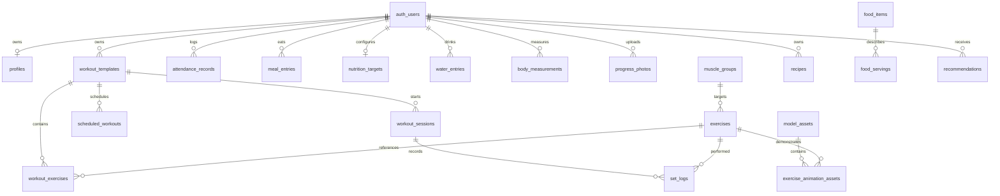

# Technical architecture and implementation plan

## Architecture

React 19/TypeScript/Vite SPA → React Router routes → TanStack Query repository → either IndexedDB (explicit device-local workspace) or Supabase Auth/PostgreSQL with owner-scoped RLS. Local data never silently uploads to an account. Zod validates mutations; constraints and policies enforce ownership in PostgreSQL. A lost cloud connection produces a retryable error, never a false local success. Private photos use signed storage URLs; service credentials exist only in Edge Functions.

## Page map

Public `/`: a procedural LMQ dumbbell, feature summaries and registration CTA. `/features`: a public product overview without detailed program prescriptions. `/programs`: redirects to account-only `/app/programs` while preserving selection; `/pricing` redirects home. `/privacy` and `/auth` provide privacy information and account entry. `/app`: dashboard. Child routes: `workouts`, `builder`, `library`, `muscles`, `programs`, `session/:id`, `nutrition`, `attendance`, `progress`, `coach`, `settings`. A signed-in account is required for every `/app` route, including the member device workspace. A stored local-mode flag is not authentication. Onboarding is editable in settings without deleting history.

## Database ERD

Templates have a JSON prescription for an atomic MVP save; normalized workout_exercises is reserved for catalog expansion. Sessions and set logs are normalized. Composite ownership foreign keys prevent cross-user references even with a forged payload. All dates use the user's IANA timezone; timestamps are UTC.

## Three.js scene architecture

Lazy-loaded Canvas, capped DPR, no external HDR dependency, procedural dumbbell with stacked plates, textured LMQ endcaps and grip detail. GSAP ScrollTrigger changes the sculpture's pose with page scroll. OrbitControls provide touch and mouse manipulation. Reduced motion switches to on-demand frames; visibility suspends continuous rendering; unsupported WebGL falls back to a branded static graphic. Core forms never depend on Canvas.
AssetViewer loads only reviewed model metadata with license and attribution. It uses region → node maps, raycasting, OrbitControls, camera presets and AnimationMixer actions from useAnimations. Keyboard muscle buttons mirror selection. Clip controls appear only when a reviewed clip exists. No primitive human substitute is shipped as anatomy.

## Asset strategy

The hero is a decorative procedural gym prop, not an exercise demonstration. No third-party human model or motion is bundled. Anatomy requires licensed GLB, named muscle nodes reviewed for region accuracy, compression, attribution and provenance. Exercise clips require documented human technique review before approved status. Until then the app supplies written exercise guidance and clearly reports that no reviewed 3D demo is available. No static demonstration is fabricated. Nutrition is entered from a user's packaging/source; Malaysian food names are suggestions without made-up nutrient values.

## Milestones

1. Foundation: design, routes, repository, schema, local persistence and Supabase connector.
2. MVP: onboarding, template builder, resumable session logging, attendance, manual-source nutrition and measurement charts.
3. 3D infrastructure and public landing; validate offline/static alternatives.
4. Security and domain tests, browser workflows, production build and deployment docs.
5. External prerequisites: connect and migrate a real Supabase project, verify deployed Auth/RLS/Storage/Edge Function; source and professionally validate human assets and food composition data. These cannot be claimed complete from a local build.
6. Expanded personalization, curated athlete-reference review, photos UI, admin publishing, optional server-side AI and subscriptions follow once prerequisites are verified.
